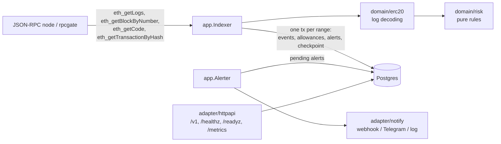

# chainwatch

Watches Ethereum wallets for risky ERC-20 approvals and the drains that follow them.

## Problem

Most wallet drains do not steal a private key. The victim signs an ERC-20
`approve` on a phishing site, giving a scammer an **unlimited allowance**, and the
tokens leave hours or days later through `transferFrom`. The signature looks
routine and nothing happens right away, so nobody notices until the balance is gone.

Individuals, small funds and DAO treasuries rarely monitor their open allowances.
Block explorers show them if you know to look, but nobody looks every day. The cost
is the whole token balance, and it keeps growing for as long as the allowance stays
open.

chainwatch keeps an up-to-date map of **who can move each watched wallet's
tokens** and alerts as soon as a risky approval or an unusual outflow is confirmed
on-chain. That leaves a window to revoke the approval before the drain, or at least
to learn about it minutes later rather than days.

## What it does

- Watches a list of wallets (managed through the API) on any EVM chain, through any
  JSON-RPC endpoint.
- Indexes ERC-20 `Approval` and `Transfer` logs where a watched wallet is the
  owner, sender or recipient, `confirmations` blocks behind head.
- Maintains `allowances(owner, token, spender, amount)`, the current exposure.
- Runs four risk rules on every event:

  | Rule | Severity | Fires when |
  |---|---|---|
  | `unlimited_approval` | high | an approval of at least 2^255 |
  | `approval_to_eoa` | high | a non-zero approval to an address with no code (typical drainer pattern) |
  | `large_outflow` | medium | a transfer out above a per-token threshold |
  | `drain_pattern` | critical | a transfer out, moved by or sent to a spender the wallet approved on that token within the last N blocks |

- Persists alerts, de-duplicated per `(rule, tx, log index)`, and delivers them via
  a webhook (with an `Idempotency-Key`), Telegram or the log. A notifier outage
  delays alerts but never drops them.
- Survives restarts (checkpoint), chain reorganisations (hash check and rewind) and
  node limits (range halving).

**Limits, stated up front.** chainwatch does not cover NFT approvals, Permit2 or the
mempool, and runs one chain per process. New wallets are tracked from the moment they
are added; their older approvals are not backfilled yet. Allowances come from
`Approval` events, and many tokens do not emit one when `transferFrom` spends an
allowance, so a finite allowance shown by the API is an upper bound. Unlimited
allowances are exact.

## Architecture



The indexer loop:

1. Read head; the target is `head - confirmations`.
2. Compare the checkpoint's stored block hash with the canonical one. On mismatch,
   rewind `reorg_window` blocks in one transaction (delete derived rows, rebuild
   allowances) and continue from there ([ADR 0002](docs/adr/0002-reorg-handling.md)).
3. For each range: read the hash of its last block, then its logs (two filters:
   watched wallet as topic 1, and as topic 2 for inflows). If the node refuses the
   range, halve it, down to a single block.
4. Decode, evaluate rules (looking up spender code and transaction sender only
   when a rule needs them), and commit events, allowances, alerts and the new
   checkpoint in **one transaction**. Re-running a range is a no-op.

Layers follow `domain` ← `app` ← `adapter` ← `cmd`. The package map lives in
[docs/ARCHITECTURE.md](docs/ARCHITECTURE.md#package-map).

## Quick start

Requirements: Go 1.24+, Docker, [Foundry](https://book.getfoundry.sh/) (for the
demo and contract tests).

```sh
git clone --recurse-submodules https://github.com/Amadeus-22/chainwatch
cd chainwatch
make check            # vet, gofmt, unit tests with -race
make contracts-test   # forge test
make demo             # end-to-end drain on anvil (below)
```

### End-to-end demo

`make demo` (`scripts/demo.sh`) starts Postgres and anvil with Docker Compose,
deploys a test ERC-20 and mints 1000 CWT to a victim account, runs chainwatch
watching the victim, then plays `contracts/script/Drain.s.sol`: the victim signs an
unlimited `approve` to an attacker EOA, and the attacker calls `transferFrom` for
the whole balance. The script prints what the API reports and tears everything
down (`DEMO_KEEP=1` keeps the containers).

An abridged real run:

```text
==> GET /v1/wallets/0x7099…79C8/allowances
{ "allowances": [ { "token": "0x5fbdb2315678afecb367f032d93f642f64180aa3",
                    "spender": "0x3c44cdddb6a900fa2b585dd299e03d12fa4293bc",
                    "amount": "115792089237316195423570985008687907853269984665640564039457584007913129639935",
                    "unlimited": true, "updated_block": 8 } ] }

==> GET /v1/alerts?wallet=0x7099…79C8
  drain_pattern       critical  block 9  delivered
  large_outflow       medium    block 9  delivered
  approval_to_eoa     high      block 8  delivered
  unlimited_approval  high      block 8  delivered

==> Metrics
chainwatch_events_total{kind="approval"} 1
chainwatch_events_total{kind="transfer"} 2
chainwatch_head_lag_blocks 2
chainwatch_reorgs_total 0

==> Demo passed: 4 alerts raised for the drained wallet
```

The demo uses host ports 55432 (Postgres), 18545 (anvil) and 28080 (API). Override
them with `CHAINWATCH_PG_PORT`, `CHAINWATCH_ANVIL_PORT` and `DEMO_HTTP_PORT`.

### Running it yourself

```sh
docker compose -f deploy/docker-compose.yml up -d postgres anvil
cp .env.example .env   # edit as needed
make run
curl -X POST localhost:8080/v1/wallets -d '{"address":"0x70997970C51812dc3A010C7d01b50e0d17dc79C8"}'
```

Or build and run the whole stack in containers:
`docker compose -f deploy/docker-compose.yml up -d --build`. The image is built from
`deploy/Dockerfile` (multi-stage, distroless, non-root).

### Tests

| Command | Covers |
|---|---|
| `make test` | domain (decoding with real anvil and mainnet logs, every rule), indexer with a fake chain (reorg rewind, range halving, idempotent reprocessing, restart from checkpoint, RPC failure), alerter retry without duplicates, JSON-RPC client, notifiers and API over `httptest` |
| `make test-integration` | the above plus the Postgres store against a real database (needs `docker compose up -d postgres`) |
| `make contracts-test` | Foundry unit and fuzz tests of the test token, including the drain scenario |

## Configuration

Environment variables only. They are validated at startup, and every problem is
reported at once.

| Variable | Default | Description |
|---|---|---|
| `CHAINWATCH_RPC_URL` | required | JSON-RPC HTTP endpoint (node, provider or rpcgate) |
| `CHAINWATCH_DATABASE_URL` | required | Postgres URL; migrations run at startup |
| `CHAINWATCH_HTTP_ADDR` | `:8080` | API listen address |
| `CHAINWATCH_LOG_LEVEL` | `info` | `debug`, `info`, `warn`, `error` |
| `CHAINWATCH_CONFIRMATIONS` | `12` | blocks behind head before a block is indexed |
| `CHAINWATCH_REORG_WINDOW` | `64` | blocks rewound when a reorg is detected |
| `CHAINWATCH_MAX_BLOCK_RANGE` | `2000` | largest `eth_getLogs` range; halved automatically on refusal |
| `CHAINWATCH_START_BLOCK` | confirmed head | first block on a fresh database |
| `CHAINWATCH_POLL_INTERVAL` | `6s` | wait between syncs; also the base of the error backoff |
| `CHAINWATCH_RPC_TIMEOUT` | `10s` | timeout per JSON-RPC call |
| `CHAINWATCH_DRAIN_WINDOW_BLOCKS` | `7200` | how long after an approval an outflow counts as `drain_pattern` (≈1 day on mainnet) |
| `CHAINWATCH_LARGE_OUTFLOW` | empty | `token=amount,…` thresholds in base units; tokens not listed are not checked |
| `CHAINWATCH_NOTIFY_INTERVAL` | `2s` | how often pending alerts are delivered |
| `CHAINWATCH_WEBHOOK_URL` | empty | POST alerts as JSON here |
| `CHAINWATCH_TELEGRAM_BOT_TOKEN` | empty | Telegram bot token (with chat id; exclusive with webhook) |
| `CHAINWATCH_TELEGRAM_CHAT_ID` | empty | Telegram chat to message |
| `CHAINWATCH_SHUTDOWN_TIMEOUT` | `15s` | grace period for in-flight HTTP requests |

With no webhook and no Telegram configured, alerts are written to the log.

## API

JSON in and out. Errors look like
`{"error":{"code":"invalid_address","message":"..."}}`, with a matching status code.
Addresses are accepted in any letter case and returned lowercase. Amounts are
decimal strings in token base units, because a `uint256` does not fit in a JSON
number.

| Method and path | Description |
|---|---|
| `POST /v1/wallets` | body `{"address":"0x…","label":"…"}`; `201` if created, `200` if already watched |
| `GET /v1/wallets` | list watched wallets |
| `DELETE /v1/wallets/{address}` | stop watching (`204`, or `404`); history is kept |
| `GET /v1/wallets/{address}/allowances` | non-zero allowances: `token`, `spender`, `amount`, `unlimited`, `updated_block` |
| `GET /v1/alerts?wallet=&since=&limit=` | newest first; `since` is RFC 3339; `limit` 1–1000 (default 100) |
| `GET /healthz` | process is alive |
| `GET /readyz` | Postgres and RPC reachable (`503` with per-check detail otherwise) |
| `GET /metrics` | Prometheus |

Webhook payload (header `Idempotency-Key` equals `dedup_key`):

```json
{"dedup_key":"drain_pattern:0x9d2b…6c6c:0","alert_id":4,"wallet":"0x7099…79c8",
 "rule":"drain_pattern","severity":"critical","reason":"…","token":"0x5fbd…0aa3",
 "tx_hash":"0x9d2b…6c6c","log_index":0,"block_number":9,"created_at":"…"}
```

## Metrics

| Metric | Type | Meaning |
|---|---|---|
| `chainwatch_indexed_block` | gauge | last committed block |
| `chainwatch_head_lag_blocks` | gauge | head minus last committed block (includes confirmations) |
| `chainwatch_events_total{kind}` | counter | indexed `approval` / `transfer` events |
| `chainwatch_findings_total{rule}` | counter | rule findings |
| `chainwatch_reorgs_total` | counter | reorgs detected at the checkpoint |
| `chainwatch_rpc_errors_total{method}` | counter | failed JSON-RPC calls |
| `chainwatch_alerts_pending` | gauge | alerts not yet delivered; a rising value means the notifier is down |

Suggested alerts: `head_lag_blocks` well above `CONFIRMATIONS` for 10 minutes
(indexer stuck), `alerts_pending > 0` for 10 minutes (notifier down), any increase of
`reorgs_total` on chains that should not reorg past the confirmation depth.

## Failure behaviour

| Failure | Behaviour |
|---|---|
| RPC error or timeout | the sync fails, the checkpoint is unchanged, retry with jittered exponential backoff; `chainwatch_rpc_errors_total` |
| `eth_getLogs` range refused | halve the range and retry, down to one block; grow back after successes |
| Reorg | hash mismatch at the checkpoint → rewind `reorg_window` blocks in one transaction and re-index; `chainwatch_reorgs_total` |
| Notifier down | alert stays `pending`, retried with backoff up to 10 minutes apart; never lost, never marked delivered twice |
| Crash or restart | resumes from the checkpoint; inserts are idempotent |
| SIGTERM | stops accepting requests, finishes in-flight ones, stops workers |

## Design decisions

- [ADR 0001](docs/adr/0001-polling-eth-getlogs.md): poll `eth_getLogs` rather than use WebSocket subscriptions
- [ADR 0002](docs/adr/0002-reorg-handling.md): reorg handling with a checkpoint hash, a rewind window and re-indexing
- [ADR 0003](docs/adr/0003-no-abi-library.md): no ABI library; the two events are decoded by hand
- [ADR 0004](docs/adr/0004-postgres.md): PostgreSQL as the store

## Roadmap

- **Next**: backfill a wallet's approvals when it is added; read on-chain
  `allowance()` to replace the upper bound with the exact value.
- **Phase 2**: Helm chart; Grafana dashboard; runs behind
  [rpcgate](https://github.com/Amadeus-22/rpcgate) in the same cluster.
- **Phase 3**: Permit2 and NFT approvals; a "revoke" transaction builder.

## License

[MIT](LICENSE)
