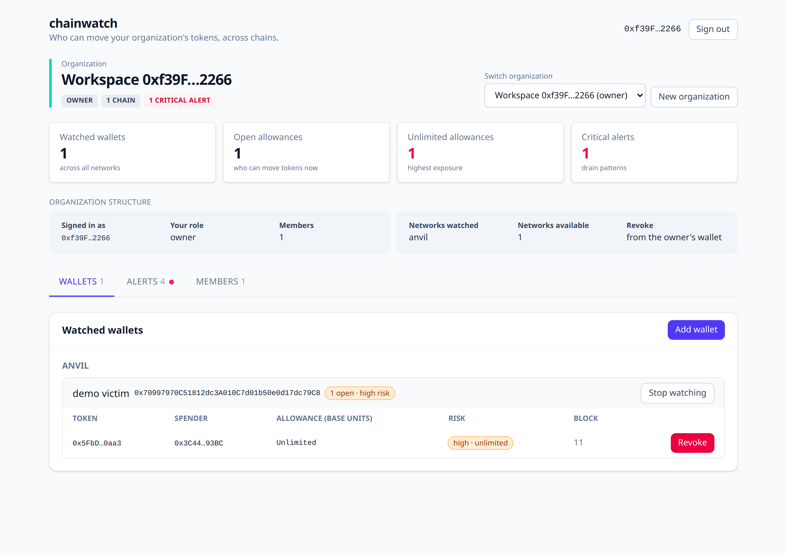
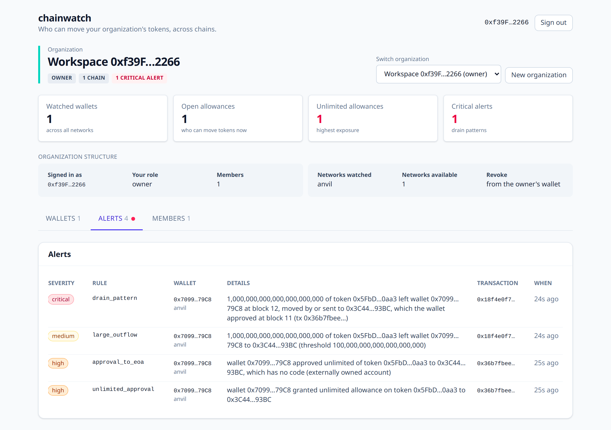
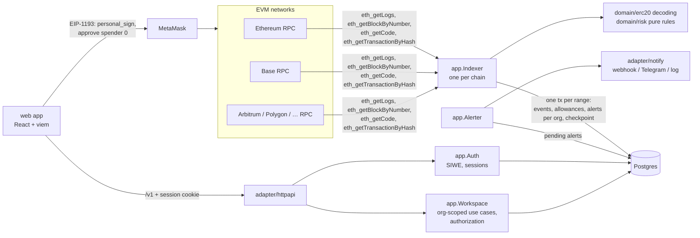

# chainwatch

Allowance and drain monitoring for treasuries, funds and DAOs: see who can move
your organization's tokens on every EVM chain you use, get alerted when a risky
approval lands, and revoke it from the browser with MetaMask.



<sub>The dashboard after `make demo`: a wallet signs an unlimited approval to an attacker's EOA and is drained; chainwatch raises four alerts and offers to revoke.</sub>



## Problem

Most wallet drains do not steal a private key. Someone with signing rights signs
an ERC-20 `approve` on a phishing site, giving a scammer an **unlimited
allowance**, and the tokens leave hours or days later through `transferFrom`. The
signature looks routine and nothing happens right away, so nobody notices until
the balance is gone.

Organizations are more exposed than individuals, not less. A fund or a DAO
treasury has several operators, wallets on Ethereum and on L2s, and years of
approvals granted to protocols, some of which are later exploited or abandoned.
Block explorers show open allowances if you know to look, one address and one
chain at a time; nobody looks every day. The cost is the whole token balance, and
it keeps growing for as long as the allowance stays open.

chainwatch keeps an up-to-date map of **who can move each watched wallet's
tokens**, across chains, for a whole team. It alerts as soon as a risky approval
or an unusual outflow is confirmed, and the owner can revoke the allowance from
the dashboard. That leaves a window to act before the drain, or at least to learn
about it minutes later rather than days.

## What it does

- **Organizations and members.** Each team (fund, treasury desk, DAO) is an
  organization with owners and members. Wallets, allowance views and alerts
  belong to one organization and are invisible to others.
- **Sign-In with Ethereum** (EIP-4361). Members sign in with the wallet they
  already use; no passwords. Sessions are HTTP-only cookies.
- **Multi-chain.** One process indexes every configured EVM network (Ethereum,
  Base, Arbitrum, Polygon, anvil…); a watched wallet is a `(chain, address)` pair.
- **Web app** (`web/`). Connect MetaMask, sign in, add wallets by connecting them
  or by address, see allowances per wallet with risk badges and the alert feed,
  and **Revoke**: the app builds `approve(spender, 0)` and MetaMask asks the owner
  to sign it, switching network if needed. chainwatch never holds keys.
- **Indexing.** ERC-20 `Approval` and `Transfer` logs where a watched wallet is
  the owner, sender or recipient, `confirmations` blocks behind head, maintaining
  `allowances(chain, owner, token, spender, amount)`, the current exposure.
- **Four risk rules** on every event:

  | Rule | Severity | Fires when |
  |---|---|---|
  | `unlimited_approval` | high | an approval of at least 2^255 |
  | `approval_to_eoa` | high | a non-zero approval to an address with no code (typical drainer pattern) |
  | `large_outflow` | medium | a transfer out above a per-token threshold |
  | `drain_pattern` | critical | a transfer out, moved by or sent to a spender the wallet approved on that token within the last N blocks |

- **Alerts** persisted per organization, de-duplicated per
  `(organization, chain, rule, tx, log index)`, and delivered via a webhook (with
  an `Idempotency-Key`), Telegram or the log. A notifier outage delays alerts but
  never drops them.
- **Reliability.** Survives restarts (per-chain checkpoints), chain
  reorganisations (hash check and rewind) and node limits (range halving); one
  chain's RPC outage does not stall the others.

**Limits, stated up front.** chainwatch does not cover NFT approvals, Permit2 or
the mempool. New wallets are tracked from the moment they are added; their older
approvals are not backfilled yet. Allowances come from `Approval` events, and many
tokens do not emit one when `transferFrom` spends an allowance, so a finite
allowance shown is an upper bound; unlimited allowances are exact. Amounts are
shown in token base units (no symbols or decimals yet). Smart-contract wallets
(Safe) can be watched, but members sign in and revoke with EOAs; Safe revoke
transactions and EIP-1271 sign-in are on the roadmap. Alerts go to one
process-wide notifier (with `org_id` in the payload), not yet per organization.

## Architecture



Chain data (events, allowances, checkpoints) is stored once per chain and shared;
access to it always goes through an organization's watch list
([ADR 0005](docs/adr/0005-multi-tenancy.md)). Every API use case checks the
caller's membership in `app.Workspace` before touching data, and the SQL is scoped
by organization as a second line of defence.

The indexer loop:

For each configured chain, concurrently:

1. Read head; the target is `head - confirmations`.
2. Compare the checkpoint's stored block hash with the canonical one. On mismatch,
   rewind `reorg_window` blocks in one transaction (delete derived rows, rebuild
   allowances) and continue from there ([ADR 0002](docs/adr/0002-reorg-handling.md)).
3. For each range: read the hash of its last block, then its logs (two filters:
   watched wallet as topic 1, and as topic 2 for inflows). If the node refuses the
   range, halve it, down to a single block.
4. Decode, evaluate rules (looking up spender code and transaction sender only
   when a rule needs them), create one alert per organization watching the
   wallet, and commit events, allowances, alerts and the new checkpoint in **one
   transaction**. Re-running a range is a no-op.

Layers follow `domain` ← `app` ← `adapter` ← `cmd`. The package map lives in
[docs/ARCHITECTURE.md](docs/ARCHITECTURE.md#package-map).

## Quick start

Requirements: Go 1.24+, Docker, [Foundry](https://book.getfoundry.sh/) (demo and
contract tests), Node 20+ (web app).

```sh
git clone --recurse-submodules https://github.com/Amadeus-22/chainwatch
cd chainwatch
make check            # vet, gofmt, unit tests with -race
make contracts-test   # forge test
make web-test web     # Vitest, then build web/dist
make demo             # end-to-end drain on anvil (below)
```

### End-to-end demo

`make demo` (`scripts/demo.sh`) starts Postgres and anvil with Docker Compose,
deploys a test ERC-20 and mints 1000 CWT to a victim account, and runs chainwatch
with a one-chain YAML network list. It then signs in with Ethereum as anvil's
first account (the EIP-4361 message is signed by `cast wallet sign`, exactly what
MetaMask would sign), which creates that account's organization, and watches the
victim on chain 31337 in it. Finally it plays `contracts/script/Drain.s.sol`: the
victim signs an unlimited `approve` to an attacker EOA, and the attacker calls
`transferFrom` for the whole balance. The script prints the organization's
allowances, alerts and metrics, checks that all four rules fired, and tears
everything down (`DEMO_KEEP=1` keeps the containers).

The demo uses host ports 55432 (Postgres), 18545 (anvil) and 28080 (API). Override
them with `CHAINWATCH_PG_PORT`, `CHAINWATCH_ANVIL_PORT` and `DEMO_HTTP_PORT`.

### Running it yourself

```sh
docker compose -f deploy/docker-compose.yml up -d postgres anvil
cp .env.example .env   # single anvil chain, SIWE domain localhost:5173
make run               # API on 127.0.0.1:8080
make web-dev           # web app on http://localhost:5173, proxying /v1 to the API
```

Open http://localhost:5173, connect MetaMask to the anvil network (chain id
31337, RPC `http://127.0.0.1:18545`), sign in, and add a wallet. For real
networks, copy `deploy/chains.example.yaml`, set `CHAINWATCH_CHAINS_FILE` to it
(and the provider key it references), and set `CHAINWATCH_SIWE_DOMAIN` to the host
users open.

In production chainwatch serves the built app itself: `make web` and
`CHAINWATCH_WEB_DIR=web/dist`, so the API and the app share one origin and the
session cookie stays first-party. The container image does this already:
`docker compose -f deploy/docker-compose.yml up -d --build`, then open
http://localhost:8080 (image built from `deploy/Dockerfile`: multi-stage,
distroless, non-root).

### Tests

| Command | Covers |
|---|---|
| `make test` | domain (decoding with real anvil and mainnet logs, every rule, Keccak/EIP-55 vectors, SIWE parsing and validation incl. a `cast`-signed fixture), indexer with fake chains (two chains side by side, reorg rewind, range halving, idempotent reprocessing, restart), SIWE sign-in (replay, expiry, wrong domain/chain/signer), tenant isolation in every use case, alerter retry without duplicates, JSON-RPC client, notifiers, and the API over `httptest` with real sessions |
| `make test-integration` | the above plus the Postgres store against a real database: tenant-scoped queries, single-use nonces, sessions, per-chain rewind (needs `docker compose up -d postgres`) |
| `make web-test` | Vitest: `approve(spender, 0)` calldata, SIWE message (byte-exact and against viem), wallet error mapping, formatting |
| `make contracts-test` | Foundry unit and fuzz tests of the test token, including the drain scenario |

## Configuration

Environment variables, plus an optional YAML file for the network list. Everything
is validated at startup, and every problem is reported at once.

| Variable | Default | Description |
|---|---|---|
| `CHAINWATCH_DATABASE_URL` | required | Postgres URL; migrations run at startup |
| `CHAINWATCH_CHAINS_FILE` | — | YAML list of networks (see below); or use the next three for one chain |
| `CHAINWATCH_RPC_URL` | — | single-chain mode: JSON-RPC HTTP endpoint (node, provider or rpcgate) |
| `CHAINWATCH_CHAIN_ID` | — | single-chain mode: EIP-155 chain id (required with `RPC_URL`) |
| `CHAINWATCH_CHAIN_NAME` | `Chain <id>` | single-chain mode: display name |
| `CHAINWATCH_SIWE_DOMAIN` | required | host[:port] users open the web app on; sign-in messages must name it |
| `CHAINWATCH_SESSION_TTL` | `24h` | session lifetime |
| `CHAINWATCH_COOKIE_SECURE` | `true` | `Secure` flag of the session cookie; `false` only for plain-http local setups |
| `CHAINWATCH_WEB_DIR` | empty | serve the built web app (`web/dist`) from this directory |
| `CHAINWATCH_HTTP_ADDR` | `:8080` | API listen address |
| `CHAINWATCH_LOG_LEVEL` | `info` | `debug`, `info`, `warn`, `error` |
| `CHAINWATCH_CONFIRMATIONS` | `12` | default: blocks behind head before a block is indexed |
| `CHAINWATCH_REORG_WINDOW` | `64` | default: blocks rewound when a reorg is detected |
| `CHAINWATCH_MAX_BLOCK_RANGE` | `2000` | default: largest `eth_getLogs` range; halved automatically on refusal |
| `CHAINWATCH_START_BLOCK` | confirmed head | default: first block on a fresh database |
| `CHAINWATCH_POLL_INTERVAL` | `6s` | default: wait between syncs; also the base of the error backoff |
| `CHAINWATCH_LARGE_OUTFLOW` | empty | default: `token=amount,…` thresholds in base units; tokens not listed are not checked |
| `CHAINWATCH_RPC_TIMEOUT` | `10s` | timeout per JSON-RPC call |
| `CHAINWATCH_DRAIN_WINDOW_BLOCKS` | `7200` | how long after an approval an outflow counts as `drain_pattern` |
| `CHAINWATCH_NOTIFY_INTERVAL` | `2s` | how often pending alerts are delivered |
| `CHAINWATCH_WEBHOOK_URL` | empty | POST alerts as JSON here |
| `CHAINWATCH_TELEGRAM_BOT_TOKEN` | empty | Telegram bot token (with chat id; exclusive with webhook) |
| `CHAINWATCH_TELEGRAM_CHAT_ID` | empty | Telegram chat to message |
| `CHAINWATCH_SHUTDOWN_TIMEOUT` | `15s` | grace period for in-flight HTTP requests |

"default" variables apply to every chain that does not set the field in the YAML
file. With no webhook and no Telegram configured, alerts are written to the log.

### Networks

`CHAINWATCH_CHAINS_FILE` is decoded strictly (unknown keys are errors); `${VAR}`
in `rpc_url` is expanded from the environment so provider keys stay out of the
file. [`deploy/chains.example.yaml`](deploy/chains.example.yaml) configures:

| Network | Chain id | Confirmations | Why |
|---|---|---|---|
| Ethereum | 1 | 12 | ~2.4 min at 12 s blocks; deeper reorgs are rare |
| Base | 8453 | 30 | ~1 min at 2 s blocks; sequencer blocks do not reorg in practice |
| Arbitrum One | 42161 | 120 | ~30 s at 0.25 s blocks |
| Polygon PoS | 137 | 128 (reorg window 256) | ~4.5 min at 2 s blocks; Polygon has reorged dozens of blocks |

```yaml
chains:
  - id: 8453
    name: Base
    rpc_url: https://base-mainnet.g.alchemy.com/v2/${ALCHEMY_API_KEY}
    explorer_url: https://basescan.org   # optional: links in the web app
    confirmations: 30
    poll_interval: 4s
    max_block_range: 2000
    large_outflow: { "0x833589fCD6eDb6E08f4c7C32D4f71b54bdA02913": "100000000000" }
```

`/readyz` checks each chain's RPC with `eth_chainId` and fails if the node serves
a different chain than configured.

## API

JSON in and out, under `/v1`. Errors look like
`{"error":{"code":"invalid_address","message":"..."}}`, with a matching status code
(`401 unauthenticated`, `403 forbidden` for another organization's data, `404`,
`409 conflict`, `400 invalid_*`). Addresses are accepted in any letter case and
returned lowercase (the signed-in address is EIP-55). Amounts are decimal strings
in token base units, because a `uint256` does not fit in a JSON number.

Authentication: a session cookie (`chainwatch_session`, HTTP-only,
`SameSite=Strict`) set by `POST /v1/auth/verify`. Unsafe requests whose `Origin`
is not `CHAINWATCH_SIWE_DOMAIN` are refused.

| Method and path | Description |
|---|---|
| `GET /v1/auth/nonce` | `{"nonce","expires_at"}`: single-use, valid 10 minutes |
| `POST /v1/auth/verify` | body `{"message":"<EIP-4361 text>","signature":"0x…"}`; sets the session cookie; the first sign-in creates a personal organization |
| `POST /v1/auth/logout` | ends the session (`204`) |
| `GET /v1/me` | signed-in address and its organizations with roles |
| `GET /v1/chains` | configured networks (`id`, `name`, `explorer_url`; never RPC URLs); no session needed |
| `POST /v1/orgs` | body `{"name":"…"}`; creates an organization owned by the caller |
| `GET /v1/orgs/{org}/members` | members and roles |
| `POST /v1/orgs/{org}/members` | owners only; body `{"address":"0x…","role":"member\|owner"}` |
| `DELETE /v1/orgs/{org}/members/{address}` | owners, or a member leaving; the last owner cannot leave (`409`) |
| `POST /v1/orgs/{org}/wallets` | body `{"chain_id":8453,"address":"0x…","label":"…"}`; `201` if created, `200` if already watched |
| `GET /v1/orgs/{org}/wallets` | the organization's watch list |
| `DELETE /v1/orgs/{org}/wallets/{chain_id}/{address}` | stop watching (`204`, or `404`); chain history is kept |
| `GET /v1/orgs/{org}/allowances?chain_id=&wallet=` | non-zero allowances of watched wallets: `chain_id`, `owner`, `token`, `spender`, `amount`, `unlimited`, `risk` (`high` if unlimited, else `medium`), `updated_block` |
| `GET /v1/orgs/{org}/alerts?chain_id=&wallet=&since=&limit=` | newest first; `since` is RFC 3339; `limit` 1–1000 (default 100) |
| `GET /healthz` | process is alive |
| `GET /readyz` | Postgres and each chain's RPC reachable and on the right chain (`503` with per-check detail otherwise) |
| `GET /metrics` | Prometheus |

Webhook payload (header `Idempotency-Key` equals `dedup_key`):

```json
{"dedup_key":"7:8453:drain_pattern:0x9d2b…6c6c:0","alert_id":4,"org_id":7,"chain_id":8453,
 "wallet":"0x7099…79c8","rule":"drain_pattern","severity":"critical","reason":"…",
 "token":"0x5fbd…0aa3","tx_hash":"0x9d2b…6c6c","log_index":0,"block_number":9,"created_at":"…"}
```

## Metrics

| Metric | Type | Meaning |
|---|---|---|
| `chainwatch_indexed_block{chain_id}` | gauge | last committed block |
| `chainwatch_head_lag_blocks{chain_id}` | gauge | head minus last committed block (includes confirmations) |
| `chainwatch_events_total{chain_id,kind}` | counter | indexed `approval` / `transfer` events |
| `chainwatch_findings_total{chain_id,rule}` | counter | rule findings (one per organization watching the wallet) |
| `chainwatch_reorgs_total{chain_id}` | counter | reorgs detected at the checkpoint |
| `chainwatch_rpc_errors_total{chain_id,method}` | counter | failed JSON-RPC calls |
| `chainwatch_alerts_pending` | gauge | alerts not yet delivered; a rising value means the notifier is down |

Suggested alerts: `head_lag_blocks` well above the chain's confirmations for 10 minutes
(indexer stuck), `alerts_pending > 0` for 10 minutes (notifier down), any increase of
`reorgs_total` on chains that should not reorg past the confirmation depth.

## Failure behaviour

| Failure | Behaviour |
|---|---|
| RPC error or timeout | that chain's sync fails, its checkpoint is unchanged, retry with jittered exponential backoff; other chains continue; `chainwatch_rpc_errors_total` |
| RPC on the wrong network | `/readyz` reports the `eth_chainId` mismatch for that chain |
| Replayed, expired or forged sign-in | `401`; nonces are single-use and consumed only after the signature verifies |
| `eth_getLogs` range refused | halve the range and retry, down to one block; grow back after successes |
| Reorg | hash mismatch at the checkpoint → rewind `reorg_window` blocks in one transaction and re-index; `chainwatch_reorgs_total` |
| Notifier down | alert stays `pending`, retried with backoff up to 10 minutes apart; never lost, never marked delivered twice |
| Crash or restart | resumes from the checkpoint; inserts are idempotent |
| SIGTERM | stops accepting requests, finishes in-flight ones, stops workers |

## Design decisions

- [ADR 0001](docs/adr/0001-polling-eth-getlogs.md): poll `eth_getLogs` rather than use WebSocket subscriptions
- [ADR 0002](docs/adr/0002-reorg-handling.md): reorg handling with a checkpoint hash, a rewind window and re-indexing
- [ADR 0003](docs/adr/0003-no-abi-library.md): no ABI library; the two events are decoded by hand
- [ADR 0004](docs/adr/0004-postgres.md): PostgreSQL as the store
- [ADR 0005](docs/adr/0005-multi-tenancy.md): organizations own watch lists and alerts; chain data is shared, access is not
- [ADR 0006](docs/adr/0006-sign-in-with-ethereum.md): Sign-In with Ethereum, sessions, and the two crypto dependencies it needs
- [ADR 0007](docs/adr/0007-multi-chain.md): one indexer per chain in one process, networks in YAML
- [ADR 0008](docs/adr/0008-web-stack.md): Vite, React, TypeScript, Tailwind and viem; plain EIP-1193

## Roadmap

- **Next**: per-organization webhooks and Telegram chats; token symbols and
  decimals in the web app; backfill a wallet's approvals when it is added; read
  on-chain `allowance()` to replace the upper bound with the exact value.
- **Smart-contract wallets**: EIP-1271 sign-in and Safe transactions for Revoke.
- **Phase 2**: API keys for machine access; audit log; Helm chart; Grafana
  dashboard; runs behind [rpcgate](https://github.com/Amadeus-22/rpcgate).
- **Phase 3**: Permit2 and NFT approvals.

## License

[MIT](LICENSE)
