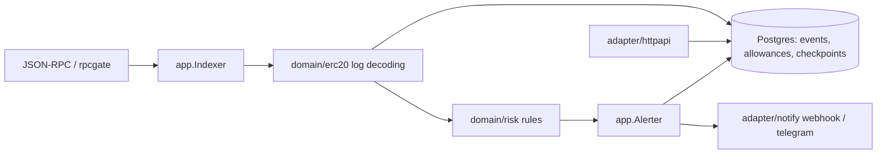

# chainwatch — Architecture

## Problem

Most wallet drains do not steal a private key. The victim signs an ERC-20
`approve` (or `permit`) that gives a scammer unlimited allowance, and the funds
leave hours or days later. Individuals, small funds and DAO treasuries rarely
monitor their open allowances. chainwatch watches chosen wallets, keeps an
up-to-date map of **who can move their tokens**, and alerts on risky approvals
and unusual outflows as soon as they are confirmed.

## MVP scope

- Watch list of wallet addresses (API). Chain access through any JSON-RPC
  endpoint (works behind `rpcgate`).
- Indexer polls `eth_getLogs` for ERC-20 `Approval` and `Transfer` topics where the
  watched wallet is owner/from/to, in block ranges, `confirmations` blocks behind head.
- **Reorg safety**: store the hash of the last processed block; if the chain's hash
  for that height differs, rewind `reorg_window` blocks, delete derived rows from that
  height and re-index. Processing a range is idempotent (unique on tx hash + log index).
- Derived state: `allowances(owner, token, spender, amount, updated_block)` — the
  current exposure.
- Risk rules (pure, each returns zero or more `Finding{rule, severity, reason}`):
  | Rule | Signal |
  |---|---|
  | `unlimited_approval` | amount ≥ 2^255 |
  | `approval_to_eoa` | spender has no code (`eth_getCode` empty): typical drainer pattern |
  | `large_outflow` | transfer out above a per-token threshold |
  | `drain_pattern` | outflow by a spender within N blocks after an approval to it |
- Alerts: persisted, de-duplicated per (rule, tx, log index); delivered through a
  `Notifier` port — generic webhook in MVP, Telegram adapter optional.
- API: `POST/GET/DELETE /v1/wallets`, `GET /v1/wallets/{addr}/allowances`,
  `GET /v1/alerts?wallet=&since=`.
- `contracts/`: Foundry project used only for local demos and end-to-end tests:
  a mintable test ERC-20 and a `forge script` that plays a drain scenario on `anvil`
  (unlimited approve to an EOA, then transferFrom). Replace the existing escrow example.

Non-goals (MVP): NFT approvals (ERC-721/1155), Permit2, multi-chain in one process,
mempool (pre-confirmation) monitoring.

## Diagram

## Package map

| Package | Responsibility |
|---|---|
| `cmd/chainwatch` | wiring: config, dependencies, start, graceful shutdown |
| `internal/domain` | `Address`, `Hash`, `Log`, `Event`, `Allowance`, `Checkpoint`, `Finding`, `Alert`; sentinel errors |
| `internal/domain/erc20` | topic constants, log decoding (topics + data, no ABI library); fixtures in `testdata/` |
| `internal/domain/risk` | rules; pure (`Evaluate`, one function per rule) |
| `internal/app` | `Indexer` (range loop, range halving, reorg detection), `Alerter`; ports `Chain`, `Store`, `Notifier` |
| `internal/adapter/ethrpc` | minimal JSON-RPC client: `eth_blockNumber`, `eth_getBlockByNumber`, `eth_getLogs`, `eth_getCode`, `eth_getTransactionByHash` (sender for `drain_pattern`) |
| `internal/adapter/postgres` | `Store` with pgx; applies `migrations/`; tests behind the `integration` tag |
| `internal/adapter/notify` | webhook, Telegram and log notifiers with retry |
| `internal/adapter/httpapi` | `/v1`, health, metrics |
| `internal/platform/config` | env parsing and validation |
| `internal/platform/logging` | slog JSON logger |
| `internal/platform/metrics` | Prometheus collectors |
| `internal/platform/backoff` | jittered exponential backoff |
| `migrations` | embedded SQL migrations (`*.sql`) |
| `contracts` | Foundry: test ERC-20, drain script (demo and end-to-end only) |

## Failure modes

| Failure | Behaviour |
|---|---|
| RPC error or timeout | retry with backoff; checkpoint unchanged; `chainwatch_rpc_errors_total` |
| `eth_getLogs` range too large | halve the range and retry, down to a single block |
| Reorg | detected by hash mismatch; rewind and re-index; `chainwatch_reorgs_total` |
| Notifier down | alert stays `pending`, retried with backoff; never lost, never duplicated |
| Restart | resumes from checkpoint; idempotent inserts |

## Metrics

`chainwatch_indexed_block`, `chainwatch_head_lag_blocks`, `chainwatch_events_total{kind}`,
`chainwatch_findings_total{rule}`, `chainwatch_reorgs_total`, `chainwatch_rpc_errors_total{method}`,
`chainwatch_alerts_pending`.

## ADRs to write

0001 polling `eth_getLogs` over WebSocket subscriptions · 0002 reorg handling ·
0003 no ABI library (hand decoding of two events) · 0004 Postgres.

## Roadmap

Phase 2: Helm chart; Grafana dashboard; runs behind rpcgate in the same cluster.
Phase 3: Permit2 and NFT approvals; "revoke" transaction builder.
