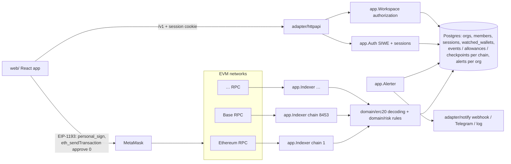

# chainwatch — Architecture

## Problem

Most wallet drains do not steal a private key. The victim signs an ERC-20
`approve` (or `permit`) that gives a scammer unlimited allowance, and the funds
leave hours or days later. Treasuries, funds and DAOs hold assets on several
chains, operated by several people, and rarely monitor their open allowances.
chainwatch watches each organization's wallets on every configured EVM chain,
keeps an up-to-date map of **who can move their tokens**, alerts on risky
approvals and unusual outflows as soon as they are confirmed, and lets the owner
revoke an allowance from the web app with MetaMask.

## Product scope (B2B)

- **Organizations** (tenants) with members (`owner`, `member`); every watched
  wallet, allowance view and alert is scoped to one organization
  ([ADR 0005](adr/0005-multi-tenancy.md)).
- **Sign-In with Ethereum** (EIP-4361) with single-use nonces and HTTP-only
  session cookies ([ADR 0006](adr/0006-sign-in-with-ethereum.md)).
- **Multi-chain**: a YAML list of EVM networks, one indexer per chain in one
  process ([ADR 0007](adr/0007-multi-chain.md)).
- **Web app** (`web/`): MetaMask via EIP-1193, dashboard, and Revoke that sends
  `approve(spender, 0)` signed by the user ([ADR 0008](adr/0008-web-stack.md)).

## Core scope

- Watch list of `(chain, address)` per organization (API). Chain access through
  any JSON-RPC endpoint (works behind `rpcgate`).
- Indexer polls `eth_getLogs` for ERC-20 `Approval` and `Transfer` topics where the
  watched wallet is owner/from/to, in block ranges, `confirmations` blocks behind head.
- **Reorg safety**: store the hash of the last processed block; if the chain's hash
  for that height differs, rewind `reorg_window` blocks, delete derived rows from that
  height and re-index. Processing a range is idempotent (unique on tx hash + log index).
- Derived state: `allowances(chain, owner, token, spender, amount, updated_block)`
  — the current exposure, shared by all organizations watching the owner.
- Risk rules (pure, each returns zero or more `Finding{rule, severity, reason}`):
  | Rule | Signal |
  |---|---|
  | `unlimited_approval` | amount ≥ 2^255 |
  | `approval_to_eoa` | spender has no code (`eth_getCode` empty): typical drainer pattern |
  | `large_outflow` | transfer out above a per-token threshold |
  | `drain_pattern` | outflow by a spender within N blocks after an approval to it |
- Alerts: one per organization watching the wallet, de-duplicated per
  (org, chain, rule, tx, log index); delivered through a `Notifier` port —
  webhook, Telegram or log.
- API: SIWE (`/v1/auth/nonce`, `/v1/auth/verify`, `/v1/auth/logout`), `/v1/me`,
  `/v1/chains`, and per organization `/v1/orgs/{org}/{wallets,allowances,alerts,members}`.
- `contracts/`: Foundry project used only for local demos and end-to-end tests:
  a mintable test ERC-20 and a `forge script` that plays a drain scenario on `anvil`
  (unlimited approve to an EOA, then transferFrom). Replace the existing escrow example.

Non-goals (for now): NFT approvals (ERC-721/1155), Permit2, mempool
(pre-confirmation) monitoring, EIP-1271 (smart-contract wallet) sign-in,
per-organization notification channels.

## Diagram

## Package map

| Package | Responsibility |
|---|---|
| `cmd/chainwatch` | wiring: config, dependencies, start, graceful shutdown |
| `internal/domain` | `Address`, `Hash`, `Log`, `Event`, `ChainID`, `Chain`, `Wallet`, `Allowance`, `Checkpoint`, `Finding`, `Alert`; `OrgID`, `Role`, `Organization`, `Member`, `Principal`, `Session` (`org.go`); sentinel errors |
| `internal/domain/erc20` | topic constants, log decoding (topics + data, no ABI library); fixtures in `testdata/` |
| `internal/domain/risk` | rules; pure (`Evaluate`, one function per rule); `AllowanceRisk` for display |
| `internal/domain/ethsig` | Keccak-256, EIP-55 checksum, EIP-191 digest, secp256k1 recovery; the only importer of `x/crypto` and `decred/secp256k1` |
| `internal/domain/siwe` | EIP-4361 message parse/format/validate (domain, URI, chain id, time window); `cast`-signed fixture in `testdata/` |
| `internal/app` | `Indexer` (one per chain: range loop, range halving, reorg detection), `Alerter`, `Auth` (SIWE sign-in, sessions), `Workspace` (organization-scoped use cases, all authorization checks); ports `Chain`, `Store`, `AuthStore`, `OrgStore`, `Notifier` |
| `internal/app/apptest` | in-memory `AuthStore` + `OrgStore` for app and httpapi tests |
| `internal/adapter/ethrpc` | minimal JSON-RPC client: `eth_blockNumber`, `eth_getBlockByNumber`, `eth_getLogs`, `eth_getCode`, `eth_getTransactionByHash`; `Ping` checks `eth_chainId` |
| `internal/adapter/postgres` | `Store`, `AuthStore`, `OrgStore` with pgx (`store.go` indexing/alerts, `accounts.go` orgs/sessions/scoped reads); applies `migrations/`; tests behind the `integration` tag |
| `internal/adapter/notify` | webhook, Telegram and log notifiers with retry |
| `internal/adapter/httpapi` | `/v1` (SIWE, orgs, wallets, allowances, alerts, members, chains), session cookie, Origin check, health, metrics, optional static web app |
| `internal/platform/config` | env parsing and validation; chains YAML (`CHAINWATCH_CHAINS_FILE`) decoded strictly |
| `internal/platform/logging` | slog JSON logger |
| `internal/platform/metrics` | Prometheus collectors |
| `internal/platform/backoff` | jittered exponential backoff |
| `migrations` | embedded SQL migrations (`*.sql`); `0002` adds organizations, sessions and chain ids |
| `contracts` | Foundry: test ERC-20, drain script (demo and end-to-end only) |
| `deploy/chains.example.yaml` | example network list: Ethereum, Base, Arbitrum One, Polygon |
| `web` | Vite + React + TypeScript + Tailwind SPA; `src/lib` holds the tested logic (`siwe.ts`, `revoke.ts`, `ethereum.ts` EIP-1193, `api.ts`), `src/components` the UI |

## Failure modes

| Failure | Behaviour |
|---|---|
| RPC error or timeout | retry with backoff, only on that chain; checkpoint unchanged; `chainwatch_rpc_errors_total{chain_id}` |
| RPC serves the wrong chain | `/readyz` fails for that chain (`eth_chainId` mismatch) |
| Invalid or replayed sign-in | `401` (`invalid_message`, `invalid_signature`, `invalid_nonce`); nonce consumed only after the signature verifies |
| Cross-tenant request | `403 forbidden` from `app.Workspace`; SQL also scoped by organization |
| `eth_getLogs` range too large | halve the range and retry, down to a single block |
| Reorg | detected by hash mismatch; rewind and re-index; `chainwatch_reorgs_total` |
| Notifier down | alert stays `pending`, retried with backoff; never lost, never duplicated |
| Restart | resumes from checkpoint; idempotent inserts |

## Metrics

`chainwatch_indexed_block{chain_id}`, `chainwatch_head_lag_blocks{chain_id}`,
`chainwatch_events_total{chain_id,kind}`, `chainwatch_findings_total{chain_id,rule}`,
`chainwatch_reorgs_total{chain_id}`, `chainwatch_rpc_errors_total{chain_id,method}`,
`chainwatch_alerts_pending`.

## ADRs

0001 polling `eth_getLogs` over WebSocket subscriptions · 0002 reorg handling ·
0003 no ABI library (hand decoding of two events) · 0004 Postgres ·
0005 multi-tenancy · 0006 Sign-In with Ethereum and its crypto dependencies ·
0007 multi-chain · 0008 web stack.

## Roadmap

Next: per-organization webhooks; token symbols/decimals in the UI; backfill of a
new wallet's approvals; EIP-1271 sign-in and Safe revoke transactions.
Phase 2: Helm chart; Grafana dashboard; runs behind rpcgate in the same cluster.
Phase 3: Permit2 and NFT approvals.
